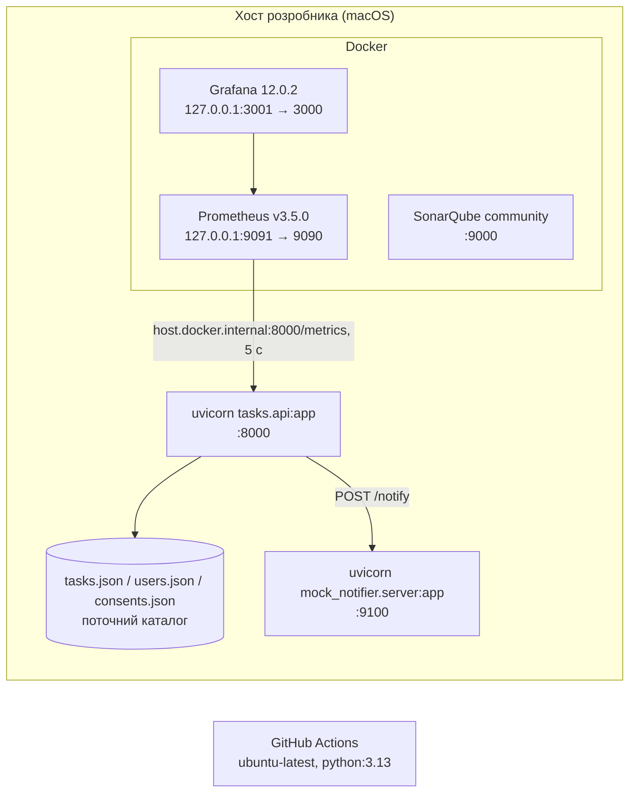

# ISD: Infrastructure Specification, Task Manager

| Поле | Значення |
|---|---|
| Версія | дата останньої зміни сторінки внизу (git-revision-date) |
| Власник документа | MarcoGr11 (за git log); формальна роль потребує підтвердження студента |
| Цикл перегляду | 90 днів (експлуатаційний), див. [[developer/maintenance]] |
| Дизайн | [[architecture/sdd]] |

<a id="isd-topology"></a>

## 1. Топологія

Усе працює на одній машині розробника. Хмарного або продакшн-розгортання немає.



| Вузол | Що запускає | Порт | Джерело |
|---|---|---|---|
| <a id="isd-api"></a>API-процес | `uvicorn tasks.api:app --port 8000` | 8000 (`prometheus.yml` scrape target) | [[architecture/sdd#sdd-api]] |
| Mock notifier | `uvicorn mock_notifier.server:app --port 9100` | 9100 (`NOTIFIER_URL` за замовчуванням) | [[architecture/sdd#sdd-mock]] |
| Prometheus | `docker compose -f docker-compose.monitoring.yml up -d` | 127.0.0.1:9091 | `docker-compose.monitoring.yml` |
| Grafana | те саме (анонімний Viewer) | 127.0.0.1:3001 | `monitoring/grafana/` |
| SonarQube | `docker compose -f docker-compose.sonar.yml up -d` | 9000 (усі інтерфейси) | `docker-compose.sonar.yml` |

<a id="isd-envs"></a>

## 2. Середовища

| Середовище | Де | Дані | Хто запускає | Стан |
|---|---|---|---|---|
| dev | локальна машина, venv Python 3.13 | JSON у поточному каталозі; `python -m tasks.seed_users` (3 користувачі, 5 задач) або `python -m tasks.seed [N]` | розробник | є |
| test | `python -m pytest` локально | `tmp_path` для кожного тесту (`tests/conftest.py`, фікстура `privacy_env`), `respx` замість мережі | розробник, pre-commit не запускає тести | є (118 passed, coverage 92% на 2026-11-27) |
| CI | GitHub Actions, контейнер `python:3.13` | лише код, без даних | push, pull_request | є, але без тестів |
| prod | – | – | – | **не існує**. Цільова платформа потребує підтвердження студента |

<a id="isd-env"></a>

## 3. Змінні оточення

Секрет серед цих змінних лише один: `BACKUP_PASSPHRASE`. `.env.example` у корені містить їх із типовими значеннями.

| Змінна | Типове значення | Хто читає | Компонент SDD |
|---|---|---|---|
| `TASKS_DB` | `tasks.json` | `tasks/api.py`, `tasks/seed_users.py` | [[architecture/sdd#sdd-storage]] |
| `USERS_DB` | `users.json` | `tasks/api.py`, `tasks/seed_users.py` | [[architecture/sdd#sdd-storage]] |
| `CONSENTS_DB` | `consents.json` | `tasks/api.py`, `tasks/seed_users.py` | [[architecture/sdd#sdd-storage]] |
| `NOTIFIER_URL` | `http://localhost:9100/notify` | `tasks/notifier_resilient.py` | [[architecture/sdd#sdd-notifier]] |
| `NOTIFIER_TIMEOUT_SECONDS` | `1.0` (секунди на одну спробу) | `tasks/notifier_resilient.py` | [[architecture/sdd#sdd-notifier]] |
| `NOTIFIER_OUTBOX` | `notifications_outbox.jsonl` | `tasks/notifier_outbox.py` | недоставлені нотифікації (з 1.1.0, [[architecture/adr/0005-notification-outbox]]). Входить у бекап |
| `CORS_ALLOW_ORIGINS` | порожньо (CORS вимкнено) | `tasks/api.py` | [[architecture/sdd#sdd-api]] |
| `BACKUP_PASSPHRASE` | немає; без нього архіви не шифруються | `scripts/backup.py` | [[runbooks/RB-001]]. Секрет: лише в оточенні, ніколи у файлах |
| `HOURLY_RATE`, `OVERLOAD_COEFF`, `DISCOUNT_RATE` | ставка обов'язкова (35-50), 1.3, 0.01 | `scripts/fin_sim.py` | не runtime (інструмент Лаби 9) |
| `AWS_ACCESS_KEY_ID` | порожньо | код не читає. Ключ є лише в `.env.example` для перевірки gitleaks | – |
| `SONAR_TOKEN` | лише в оточенні, ніколи у файлах | `sonar-scanner` | інструмент якості |

CLI (`tasks/cli.py`) змінних не читає: працює з `./tasks.json`.

<a id="isd-storage"></a>

## 4. Сховище, бекап, відновлення, RTO/RPO

**Сховище.** Три JSON-файли на локальному диску. Рішення описано в [[architecture/adr/0001-json-file-storage|ADR-0001]]. `save_all` записує `*.tmp`, потім виконує `os.replace`. Інструмент бекапу: `scripts/backup.py` (з ЛР12). Операційна процедура: [[runbooks/RB-001]].

<a id="isd-deploy"></a>

### 4.1. Розгортання з health-перевіркою

Порядок такий: бекап, тести, перезапуск, health, smoke. Реальний прогін релізу `v1.1.0` збережено в `doc/lab12_results/deploy_drill.txt`.

1. `git fetch --tags && git checkout <тег релізу>`, потім `pip install -r requirements.txt`.
2. Бекап перед розгортанням: `python scripts/backup.py backup --dest backups`.
3. `python -m pytest -q`: червоні тести означають, що реліз не розгортається.
4. Зупинити старий процес: `kill $(lsof -tiTCP:8000 -sTCP:LISTEN)`.
5. Запустити новий процес: `uvicorn tasks.api:app --port 8000 &`.
6. Health-перевірка: `for i in $(seq 1 50); do curl -fsS localhost:8000/health && break; sleep 0.2; done`. Якщо за 10 с немає `{"status":"ok"}`, виконується відкат.
7. Smoke-перевірка: `GET /tasks` дає 200, а `GET /metrics` містить `task_store_records`.
8. Відкат: `git checkout <попередній тег>`, перезапуск (кроки 4-6). Якщо реліз мав міграцію, ще потрібне відновлення з бекапу кроку 2 за [[runbooks/RB-001]].

### 4.2. Оновлення з міграціями

Кожен реліз у [CHANGELOG](https://github.com/MarcoGr11/task_manager/blob/master/CHANGELOG.md) має пункт «Міграції»: формат даних, скрипт, зворотність. Порядок такий:

1. бекап перед міграцією;
2. зупинка застосунку;
3. ідемпотентний скрипт міграції, який друкує кількість записів до і після;
4. запуск нового коду;
5. health-перевірка;
6. порівняння кількості записів.

Міграція без зворотного скрипта відкочується лише відновленням з бекапу кроку 1. Реліз `1.1.0` міграцій не має: новий файл `NOTIFIER_OUTBOX` створюється лише під час першого збою доставки, а наявні сховища не змінюються.

### 4.3. Відновлення: спочатку дані, потім застосунок

1. Зупинити застосунок, щоб ніхто не писав у сховище, яке відновлюється.
2. Відновити й перевірити дані: `scripts/backup.py verify`, потім `restore`. Скрипт звіряє SHA-256 з маніфестом і замінює файли атомарно.
3. Запустити застосунок і виконати health-перевірку.
4. Звірити кількість записів із маніфестом.

Якщо запустити застосунок до відновлення даних, він обслуговуватиме запити з пошкодженого сховища. Запис нових даних у старий файл потім перезапише відновлення. Деталі в [[runbooks/RB-001]].

<a id="isd-rto"></a>

### 4.4. RTO і RPO

| Складова RTO | Значення | Джерело |
|---|---|---|
| Виявлення | ≤ 7 хв: вікно `rate[5m]` + `for: 2m` у `TaskStoreReadErrors` (scrape і evaluation 5 с) | `monitoring/alerts.yml` |
| Реакція on-call | ≤ 15 хв (SEV1) | [[maintenance-plan#escalation]] |
| Виконання RB-001 (зупинка → health 200) | 1349 мс виміряно (5 задач); повний бекап 5000 задач створюється за 0.069 с | `restore_drill.txt`, `backup_volume.txt` |
| Верифікація | ≤ 5 хв | RB-001 |
| **Разом** | 7 + 15 + 0.02 + 5 ≈ 27 хв | |

| Показник | Ціль | Обґрунтування |
|---|---|---|
| **RTO** | **30 хв** | 27 хв за розрахунком вище плюс запас; виконання автоматизованої частини займає секунди, основна частка припадає на людську реакцію |
| **RPO** | **1 год** | дорівнює інтервалу інкрементального бекапу. Drill підтвердив: задача, створена після останнього incr, втрачена (1 з 9) |

<a id="isd-backup"></a>

### 4.5. Backup policy

| Параметр | Значення |
|---|---|
| Обсяг | дані займають 904 409 Б (`tasks.json` 902 788, `users.json` 1 014, `consents.json` 607). З 1.1.0 до бекапу входить і `NOTIFIER_OUTBOX`: без збоїв доставки файлу немає. Повний зашифрований архів має 30 992 Б, incr без змін 384 Б (`backup_volume.txt`) |
| Розклад | повний щодня о 02:00 UTC; інкрементальний щогодини о :05 (лише файли, у яких змінився SHA-256) |
| Retention | incr 7 днів (вони потрібні лише в межах денного ланцюга), денні full 7 днів, тижневі full 4 тижні, місячні full 12 місяців. Найгірший випадок 5.44 MiB на копію (`calc.txt`) |
| Шифрування | `BACKUP_PASSPHRASE` → `openssl enc -aes-256-cbc -pbkdf2 -salt`. Ключ лише в оточенні чи сховищі секретів. Цілісність контролює SHA-256 у маніфесті всередині архіву |
| 3-2-1 | 3 копії: робочі файли, `backups/` на окремому диску, офсайт. 2 типи носіїв: локальний SSD і об'єктне сховище. 1 офсайт: зашифрований архів. Конкретне офсайт-сховище потребує підтвердження студента |
| Перевірка | `scripts/backup.py verify` для кожного нового архіву. Restore drill раз на квартал і після кожної зміни формату даних |

Розклад у cron (на машині розробника не встановлено, бо постійної prod-машини немає):

```text
0 2 * * *  cd /srv/task_manager && python scripts/backup.py backup --dest backups
5 * * * *  cd /srv/task_manager && python scripts/backup.py backup --dest backups --incremental
```

### 4.6. Restore drill

Процедуру виконано 2026-11-27 скриптом `doc/lab12/restore_drill.sh`. Вивід: `doc/lab12_results/restore_drill.txt`.

1. Ізольовані сховища в `mktemp -d`, `seed_users`: 5 задач, 3 користувачі.
2. Повний бекап, 3 нові задачі, інкрементальний бекап (`included=['tasks']`), ще 1 задача.
3. Імітація інциденту: `printf '{corrupt' > $TASKS_DB`. Результат: `GET /tasks` дає 500 тричі, `task_store_records NaN`, лічильник 5xx дорівнює 3.
4. RB-001: зупинка, збереження пошкодженого файлу, `verify` обох архівів (OK), `restore`, запуск, health 200.
5. Результат: 8 задач відновлено, 1 втрачено (вікно RPO), `task_store_records 8.0`. **RTO_measured_ms=1349.**

Попередня перевірка ЛР10 (`docs/audit/restore_drill.txt`, ручне `cp`) лишається історичною.

<a id="isd-cicd"></a>

## 5. CI/CD і Quality Gates (Лаби 1-7)

| Етап | Де | Тригер | Gate | Лаба |
|---|---|---|---|---|
| Секрети | `.githooks/pre-commit`: `gitleaks git --pre-commit --staged --redact` | кожен `git commit` | блокує коміт; allowlist у `.gitleaks.toml` | 4 |
| Цикломатична складність | `.githooks/complexity_check.sh`: radon на staged-вміст | кожен `git commit` | блокує, якщо CC > `MAX_CC=10` | 6 |
| Активація хуків | `git config core.hooksPath .githooks` | один раз після клонування | без цього хуки не працюють | 6 |
| Тести та покриття | `python -m pytest` (`pytest.ini`: `--cov=tasks --cov-report=xml:coverage.xml`) | вручну | поріг не задано (coverage 92% на 2026-11-27) | 1-4 |
| Статичний аналіз | SonarQube локально, `sonar-project.properties` (ключ `task-manager`, Python 3.13, `coverage.xml`) | вручну, `SONAR_TOKEN` з оточення | Quality Gate SonarQube; конкретний профіль потребує підтвердження студента | 1, 3 |
| CI complexity | `.github/workflows/complexity.yml` | `push`, `pull_request` | не блокує. radon 6.0.1: cc, hal, mi; churn (вся історія і 90 днів); `scripts/hotspots.py`; артефакт `complexity-reports` | 7 |
| Навантаження | k6-скрипти (локально в `doc/k6/`, не в git) | вручну | з коміту 1cbb321: безпечний максимум 60 RPS, обвал на 70 RPS | 5 |
| Документація | `.github/workflows/docs.yml`: markdownlint, Spectral, `scripts/review_dates.py`, `mkdocs build --strict`, деплой на GitHub Pages | push у будь-яку гілку (деплой лише з `master`), pull_request | червоний Job при мертвому посиланні, помилці Spectral чи markdownlint ([[architecture/adr/0004-docs-as-code-mkdocs]]) | 11 |

Останні 4 запуски CI (`gh run list --workflow complexity.yml`) усі `success`. Останній: 2026-11-08, `d0fa985`.
CD (розгортання) немає.

<a id="isd-monitoring"></a>

## 6. Моніторинг

- **Prometheus.** Збирає `host.docker.internal:8000/metrics` кожні 5 с (`monitoring/prometheus.yml`). Retention не задано, діє типове значення образу. Окремого тому для даних немає, тож дані зникають разом із контейнером.
- **Метрики API:**
    - HTTP count і latency histogram від `prometheus-fastapi-instrumentator`;
    - `app_process_cpu_percent` і `app_process_rss_bytes` через psutil.
- **Grafana.** Datasource `prom` (`http://prometheus:9090`), дашборд `monitoring/grafana/dashboards/lab5.json` «Task Manager - Lab5 Stability». Панелі: RPS, latency, CPU, RAM.
- **Логи.** stdout uvicorn, INFO. Фільтр `SensitiveDataFilter` маскує PII. Аудит-події пишуться JSON-рядками.
- **Алерти.** З ЛР12 діють 6 правил у `monitoring/alerts.yml` (`rule_files` у `prometheus.yml`, `promtool check rules`: SUCCESS). Каталог: [[runbooks/index]]. SLO: [[slo]]. Alertmanager не розгорнуто, тож алерти видно лише у вкладці Alerts Prometheus.
- **Метрика сховища.** `task_store_records`: кількість задач або `NaN`, якщо файл не читається (з ЛР12).
