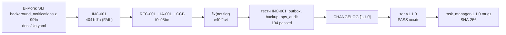

# Release checklist: 1.1.0 (go / no-go)

Реліз `1.1.0` реалізує [[change/rfc-001]] і Emergency-зміну CA-3 ([[change/ccb-protocol#ecab]]). Рішення go ухвалює SRE, коли всі обов'язкові пункти мають статус «так». Будь-яке «ні» в обов'язковому пункті означає no-go.

Сирий вивід кожної перевірки лежить у `doc/lab12_results/` під назвою з останнього стовпця.

## Перед тегом

| # | Пункт | Обов'язковий | Результат | Доказ |
|---|---|---|---|---|
| 1 | RFC у стані Approved, умови CCB відомі | так | так: Approved з умовами C1–C5 | [[change/ccb-protocol#ccb-2026-11-27]] |
| 2 | Freeze не блокує зміну | так | так: зміна підвищує надійність SLI, бюджет якого вичерпано, тож дозволена за [[slo#policy]] | RFC-001 «Обґрунтування» |
| 3 | Повний набір тестів зелений (C1), включно з регресійними тестами INC-001 | так | так: 134 passed. На коміті інциденту було 3 failed, 126 passed | `pytest_pass.txt`, `pytest_fail.txt` |
| 4 | Effectiveness check CAPA (C2) | так | так: 0 втрачених задач, 0 дублікатів, replay `delivered=162 left=0` | `incident_after_numbers.txt`, [[incidents/pm-001#capa]] |
| 5 | Replay лише вручну (C3) | так | так: автоматичного виклику `replay` у коді немає, лише CLI | `tasks/notifier_outbox.py` |
| 6 | Правила алертів валідні, новий алерт спрацьовує на формі INC-001 | так | так: `SUCCESS: 6 rules found`; `promtool test rules`: SUCCESS | `promtool_check_after.txt`, `promtool_test.txt` |
| 7 | Операційна готовність: кожен алерт має runbook, кожен SLI має алерт (PA-1) | так | так: `ops audit: OK` | `scripts/ops_audit.py` |
| 8 | Документація: `mkdocs build --strict`, markdownlint, Spectral, review_dates, doc_audit | так | так: strict без попереджень; markdownlint 0 errors; Spectral 0 errors (1 відоме попередження `info-contact`); doc_audit PASS | `mkdocs_strict.txt`, `markdownlint.txt`, `spectral.txt` |
| 9 | Цикломатична складність ≤ 10 | так | так: максимум B (10), `scripts/backup.py:restore` | хук `complexity_check.sh` |
| 10 | Секретів у коміті немає | так | так: хук gitleaks `no leaks found` на кожному коміті | вивід `git commit` |
| 11 | Міграції даних | так | немає; бекап перед розгортанням все одно робиться | CHANGELOG `[1.1.0]` |
| 12 | Зміна API зворотно сумісна | так | так: additive, `info.version` OpenAPI 1.0.1 без змін | [[change/ia-001]], рівень 4 |
| 13 | CHANGELOG містить розділ релізу | так | так: `[1.1.0]` і `[docs-v2.1]` | `CHANGELOG.md` |
| 14 | Known issues релізу задокументовані | ні | так: K-3, K-4 | [[maintenance-plan#known-issues]] |

**Рішення перед тегом: GO.**

## Після тегу (у вікні розгортання)

| # | Пункт | Обов'язковий | Доказ |
|---|---|---|---|
| 15 | Розгортання з артефакту тегу за [[architecture/isd#isd-deploy]]: бекап, тести, перезапуск | так | `deploy_drill.txt` |
| 16 | Health-перевірка `{"status":"ok"}` за ≤ 10 с, smoke `GET /tasks` 200 і `task_store_records` у `/metrics` | так | `deploy_drill.txt` |
| 17 | План відкату перевірено (C5): попередній стан `4041c7a` піднімається і проходить health, потім повторне розгортання `v1.1.0` | так | `deploy_drill.txt` |
| 18 | SHA-256 артефакту записано | так | `artifact_sha256.txt` |

Якщо пункт 16 не пройдено, виконується відкат з пункту 17 і RFC повертається на CCB.

## Трасування

| Ланка | Ідентифікатор | Як перевірити |
|---|---|---|
| Вимога | SLI `background_notifications` (SLO 99%, SLA 97%) у `docs/slo.yaml`; нефункціональна вимога «відмова виявляється ≤ 2 хв» | [[slo]] |
| Інцидент | INC-001, коміт `4041c7a` `ops(incident): capture legacy module outage, FAIL` | [[incidents/inc-001]] |
| Зміна | RFC-001, IA-001, протокол CCB, коміт `f0c95be` | [[change/rfc-001]] |
| Коміти реалізації | `e40f2c4` `fix(notifier): ...` (CA-1, CA-2, CA-3); PASS-коміт `docs(maintenance): deliver capa actions and swebok plan, PASS` (PA-1, PM-001, план супроводу) | `git log 3b40e54^..v1.1.0 --oneline` |
| Тести | `tests/test_incident_inc001.py` (червоні на `4041c7a`, зелені на `e40f2c4`), `tests/test_notifier_outbox.py`, `tests/test_backup.py`, `tests/test_ops_audit.py` | `python -m pytest -q` |
| CHANGELOG | розділ `[1.1.0]`, «Міграції: немає» | `CHANGELOG.md` |
| Тег | `v1.1.0` (анотований, локальний; push лише з дозволу власника) | `git show v1.1.0` |
| Артефакт | `git archive --format=tar.gz --prefix=task_manager-1.1.0/ v1.1.0 > task_manager-1.1.0.tar.gz` | `sha256sum task_manager-1.1.0.tar.gz` дорівнює значенню з `artifact_sha256.txt` |

Хеш PASS-коміту і SHA-256 артефакту не можуть бути записані в сам цей файл: вони залежать від його вмісту. Тому вони зберігаються поза деревом релізу (`doc/lab12_results/`), а ланка «тег → коміт» перевіряється командою `git rev-list -n1 v1.1.0`.
