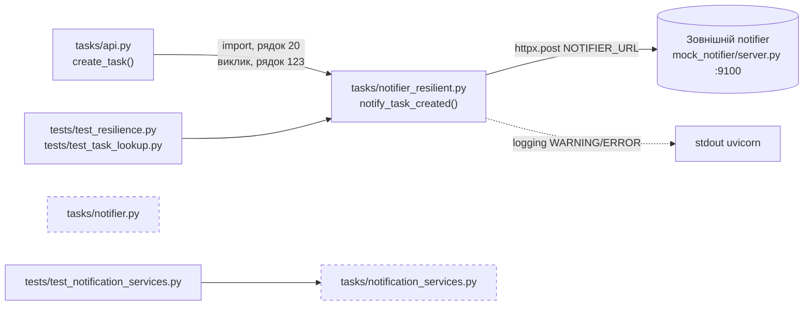

# Legacy-компонент: підсистема нотифікацій

Сирий вивід команд, на які спираються позначки **verified**, лежить у `doc/lab12_results/legacy_evidence.txt`. Позначка **assumed** означає висновок з назв, коментарів або аналогії, який не перевірено виконанням чи тестом.

## Чому саме цей компонент

За аудитом ЛР10 ([[audit/inventory]], `docs/audit/decay_metrics.txt`) підсистема нотифікацій задокументована найгірше:

| Ознака аудиту ЛР10 | Нотифікатор | Решта модулів |
|---|---|---|
| Мертві посилання з коду на документацію (§4) | 1: `notifier_resilient.py:11` → `README_LAB2.md` (DEAD) | 0 |
| Обґрунтування рішення | втрачене разом із `README_LAB2.md`; ADR-0002 записано ретроспективно лише в ЛР10 | ADR-0001 для сховища, решта не потребує |
| Незадокументовані змінні оточення (§5) | `NOTIFIER_URL` | `TASKS_DB`, `USERS_DB`, `CONSENTS_DB` (сховище) |
| Модулі, що згадуються лише в аудиті | `notification_services.py` (1 файл `docs/`) | `task_services.py`, `consent_policy.py`, `logging_utils.py` |
| Експлуатаційна документація (SLI, алерт, runbook) до ЛР12 | немає | немає |

У сховищі після ЛР10 є ADR-0001 і бекап-процедура. Тому нотифікатор лишається єдиним runtime-компонентом із зовнішньою мережевою залежністю, для якого немає ні метрики, ні алерту, ні runbook.

## Склад

| Файл | Рядків | Роль | Статус |
|---|---|---|---|
| `tasks/notifier_resilient.py` | 48 | runtime-клієнт: retry, backoff, fallback | **verified**: єдиний імпорт у runtime, `tasks/api.py:20` |
| `tasks/notifier.py` | 13 | базовий клієнт ЛР2 без retry | **verified** dead code: жодного імпорту в `tasks/`, `tests/`, `scripts/` |
| `tasks/notification_services.py` | 174 | in-memory модель e-mail-каналу (ЛР8, композиція) | **verified** поза runtime: імпортує лише `tests/test_notification_services.py`. Що це «майбутній e-mail-канал»: **assumed** за назвою |
| `mock_notifier/server.py` | 22 | керований двійник зовнішнього сервісу (режими `ok`, `error`, `timeout`) | **verified**: використано в ЛР2 і в INC-001 |

## Граф залежностей

| Ребро | Статус | Доказ |
|---|---|---|
| `api.create_task` → `notify_task_created` | verified | `tasks/api.py:20`, `:123` |
| `notify_task_created` → HTTP `POST NOTIFIER_URL` | verified | `notifier_resilient.py:38`; лог `Connection refused` у INC-001 |
| `notifier.py` і `notification_services.py` не мають runtime-входів | verified | `grep` імпортів, `legacy_evidence.txt` |
| Реальний зовнішній сервіс існує поза лабораторією | assumed | у репозиторії є лише mock; адреса prod-сервісу потребує підтвердження студента |

## Схема даних

| Обмін | Поля | Статус |
|---|---|---|
| Запит до нотифікатора (тіло `POST /notify`) | `Task.to_dict()`: `id`, `title`, `priority` (назва enum), `status`, `due_date` (ISO або `null`), `tags`, `owner_id` | verified, `tasks/models.py:44-52` |
| Відповідь mock-нотифікатора | `{"status": "sent", "task_id": <id>}`; 503 у режимі `error`; затримка 10 с у режимі `timeout` | verified, `mock_notifier/server.py` |
| Результат `notify_task_created` | `{"delivered": bool, "attempts": int}` | verified, тести `test_success_first_attempt_no_fallback` і `test_fallback_after_persistent_503` |
| Поля у відповіді `POST /tasks` | `notification_delivered`, `notification_attempts` | verified, `tasks/api.py:124-128`, OpenAPI `TaskCreated` |
| Сховище недоставлених нотифікацій | **немає**: після fallback дані нотифікації ніде не зберігаються | verified, INC-001: 163 рядки `fallback used`, повторної доставки немає |
| Ідемпотентність прийому повторного `notify` на боці сервісу | невідома | assumed, що неідемпотентний. Важливо для replay (CA-2) |

## Призначення методів

| Метод / константа | Що робить | Статус | Доказ |
|---|---|---|---|
| `notify_task_created(task)` | до 3 спроб `POST`, після вичерпання повертає `delivered=false` без винятку | verified | 6 тестів `tests/test_resilience.py`; INC-001: під час outage доставлено 1 з 164 (запит стартував о 16:55:53.711Z, до зупинки нотифікатора) |
| `_is_retryable(error)` | повторює лише `TransportError` і HTTP ≥ 500 | verified | `test_client_error_is_not_retried` |
| `backoff_delay(attempt)` | `0.2 × 2^(n−1)` плюс jitter `U(0, 0.1)` | verified | `test_retry_succeeds_after_two_failures_with_backoff` |
| `MAX_ATTEMPTS = 3` | обмеження, щоб не «добивати» нотифікатор | verified (значення); мотив **assumed** за коментарем рядка 12 |
| `TIMEOUT_SECONDS` | `NOTIFIER_TIMEOUT_SECONDS`, 1.0 с на спробу | verified | `test_notifier_timeout_default` |
| Найгірша затримка `POST /tasks` | 3 × 1.0 + 0.6 + 0.2 ≈ 3.8 с при timeout; ≈ 0.8 с при `Connection refused` | verified | ЛР2 `fault_after.txt` (3.81 с); INC-001 (p50 796.4 мс) |
| `notifier.notify_task_created` (baseline) | 1 спроба, виняток назовні | verified (код); у runtime не викликається |
| `NotificationService.send` і `EmailNotificationService.*` | in-memory відправка та історія подій, без мережі | verified тестами; бізнес-призначення assumed |

## Реєстр технічного боргу

| ID | Категорія | Борг | Доказ | Наслідок | Пріоритет | Дія |
|---|---|---|---|---|---|---|
| TD-A1 | architecture | нотифікація синхронна в шляху запиту `POST /tasks` | INC-001: p50 POST 40.3 → 796.4 мс | порушення latency SLO при кожному збої залежності | P2 | асинхронний воркер outbox (після CA-2) |
| TD-A2 | architecture | немає outbox: недоставлена нотифікація губиться назавжди | ADR-0002 «Мінуси»; INC-001: 163 втрачено | `background_notifications` SLI не відновлюється | P1 | CA-2 |
| TD-A3 | architecture | read-modify-write сховища без блокування; `TaskStorage.save` неатомарний | INC-001: 667 × 201, у сховищі 547 нових задач; 10 × `JSONDecodeError` | втрата підтверджених задач (18%) | P1 | CA-3 |
| TD-C1 | code | `tasks/notifier.py` – dead code | grep імпортів | плутанина, яка з двох функцій `notify_task_created` чинна | P3 | видалити окремим RFC |
| TD-C2 | code | `notification_services.py` (174 рядки) поза runtime, але SDD відносить його до доменної логіки | grep; SDD §3.3 | хибна картина архітектури | P3 | рішення: інтегрувати або позначити deprecated |
| TD-C3 | code | `NOTIFIER_URL` визначено у двох модулях | `notifier.py:6`, `notifier_resilient.py:9` | розбіжність при зміні | P3 | зникне разом з TD-C1 |
| TD-T1 | test | немає тестів конкурентного доступу до сховища | INC-001 знайшов дефект навантаженням, а не тестом | регресія непомітна | P1 | `test_concurrent_creates_do_not_lose_tasks` |
| TD-T2 | test | немає тестів на збереження недоставленої нотифікації і на метрику | `tests/test_incident_inc001.py` червоний на `HEAD` інциденту | — | P1 | тести INC-001 |
| TD-T3 | test | 16 тестів покривають код, який не працює в runtime | `test_notification_services.py` | хибне відчуття покриття | P3 | разом із TD-C2 |
| TD-D1 | documentation | обґрунтування ЛР2 втрачено (`README_LAB2.md`) | аудит ЛР10 §4 | ADR-0002 відновлено ретроспективно | закрито в ЛР10 | – |
| TD-D2 | documentation | для залежності немає SLI-метрики, алерту, runbook | `/metrics` без `notifier_*` (INC-001 `metrics_*.txt`); ISD §6 «Алерти не налаштовані» | інцидент тихий | P1 | CA-1, PA-1 |
| TD-D3 | documentation | SDD описує `notification_services.py` як доменний модуль | SDD §3.3 | неправдивий опис | P3 | виправити разом із TD-C2 |

Пов'язані документи: інцидент [[incidents/INC-001]], компоненти [[architecture/sdd#sdd-notifier]], [[architecture/adr/0002-notifier-retry-fallback]].
