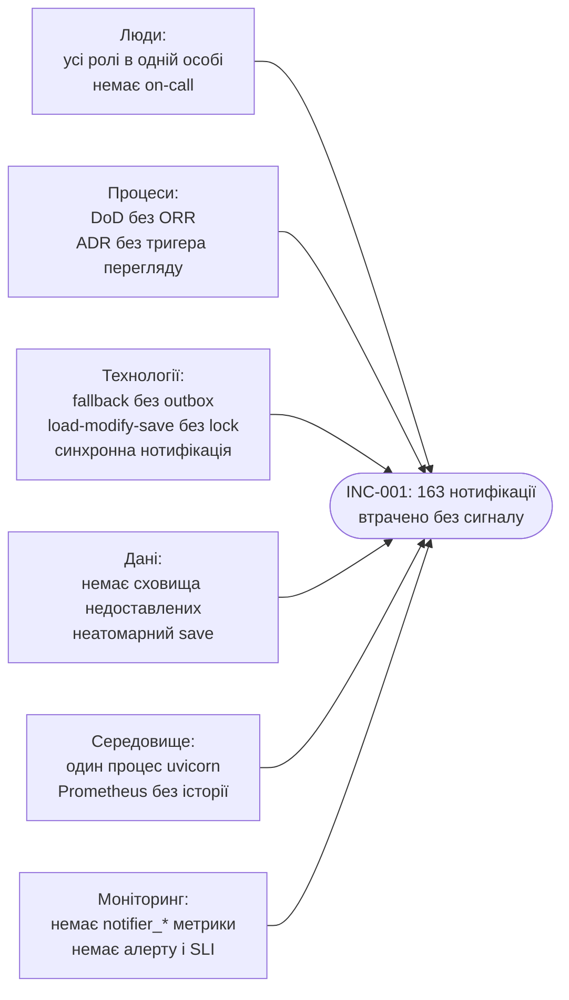

# PM-001: Blameless post-mortem до INC-001

**Принцип blameless.** Ми шукаємо, яка умова процесу дозволила дефекту дійти до експлуатації, а не хто помилився. Кожна відповідь «чому» спирається на доказ: рядок коду, коміт, лог чи метрику. Відповіді на кшталт «розробник забув» не приймаються: якщо людина могла забути, то процес не мав кроку, який би це зловив.

| Поле | Значення |
|---|---|
| Інцидент | [[incidents/INC-001]], SEV2, вплив 60.529 с, 163 нотифікації втрачено назавжди |
| Супутній дефект | втрата 120 з 667 підтверджених задач під конкурентним записом (SEV1, ECAB) |
| Учасники розбору | архітектор, QA, SRE, PO (ролі; реальних осіб потребує підтвердження студента) |
| Компонент | [[incidents/legacy-notifier]] |

## 5 Чому: тиха втрата нотифікацій

| # | Питання | Відповідь | Доказ |
|---|---|---|---|
| 1 | Чому 163 нотифікації втрачено? | Після 3 невдалих спроб `notify_task_created` лише пише ERROR у лог і повертає `delivered: false`. Нотифікацію ніде не збережено | `tasks/notifier_resilient.py:47-48` на коміті `4041c7a`; 163 рядки `fallback used` у `incident_before/api.log` |
| 2 | Чому нотифікацію не зберігали? | ADR-0002 свідомо прийняв втрату («outbox відсутній») і відклав перегляд до моменту, коли «потрібна гарантована доставка». Хто і за якою ознакою вирішує, що вона потрібна, не визначено | ADR-0002, розділ «Наслідки» |
| 3 | Чому ніхто не помітив, що цей момент настав? | Втрату не видно: у `/metrics` немає жодної серії `notifier_*`, алертів немає. HTTP-рівень під час відмови здоровий: 5xx не зросли | `metrics_end_of_outage.txt` (POST 5xx = 7 до і після); ISD §6 на `4041c7a`: «Алерти. Не налаштовані.» |
| 4 | Чому залежність увели без метрики й алерту? | Коміт `6fd3115` (2026-09-27) додав retry і fallback разом із тестами поведінки, але без операційних вимог. Обґрунтування рішення посилалося на `README_LAB2.md`, якого в репозиторії ніколи не було, тож вимоги до спостережуваності ніде не записано | `git show 6fd3115`; аудит ЛР10: мертве посилання `notifier_resilient.py:11 → README_LAB2.md` |
| 5 | Чому таку зміну можна було злити? | **Процес приймання змін не мав кроку операційної готовності.** Чек-лист docs-or-don't-merge вимагав документації, OpenAPI, ADR і CHANGELOG, але не вимагав SLI-метрики, алерту і runbook для нової зовнішньої залежності. CI перевіряв документацію, а зв'язок «SLI → алерт → runbook» не перевіряв ніхто | `docs/developer/CONTRIBUTING.md`, рядки 18–28 на `4041c7a`; `.github/workflows/docs.yml` на `4041c7a`: кроки markdownlint, Spectral, review_dates, mkdocs |

**Коренева причина (процес):** у Definition of Done немає воріт операційної готовності (ORR). Тому залежність без SLI, алерту і runbook вважалася готовою. Усуває її попереджувальна дія PA-1.

## 5 Чому: втрата задач під конкурентним записом

| # | Питання | Відповідь | Доказ |
|---|---|---|---|
| 1 | Чому 120 задач із відповіддю 201 зникли? | Два запити читають той самий список, обидва записують його з однаковим `next_id`, перемагає останній запис | 667 × 201 проти 547 нових задач (`incident_numbers.txt`) |
| 2 | Чому запити перетинаються? | FastAPI виконує синхронні обробники в пулі потоків, а `create_task` робить load-modify-save без блокування; `save` спочатку обрізає файл | `tasks/api.py` і `tasks/storage.py` на `4041c7a`; 10 × `JSONDecodeError` |
| 3 | Чому сховище не розраховане на паралельний запис? | ADR-0001 обирав JSON-файли для CLI одного користувача; коли з'явився API, рішення не переглянули | ADR-0001 «Контекст» |
| 4 | Чому дефект не знайшли тести? | Жодного тесту з паралельними запитами (TD-T1); навантажувальні тести ЛР5 перевіряли латентність, а не цілісність даних | `git grep "ThreadPool\|threading" 4041c7a -- tests` знаходить лише регресійний тест INC-001, доданий у тому ж коміті; `doc/lab5_results/summary.md` |
| 5 | Чому зміна контексту (CLI → API) не запустила перегляд ADR? | **Процес не має тригера перегляду ADR** при зміні умов, на яких рішення стоїть. Журнал ADR має правила нумерації і незмінності, але не має правила «переглянути при зміні контексту» | [[architecture/adr/index]], розділ «Правила» |

## Діаграма Ішікави

## CAPA

Коригувальна дія (corrective) усуває причину вже виявленої невідповідності. Попереджувальна дія (preventive) усуває причину потенційної невідповідності, щоб вона не виникла деінде.

| ID | Тип | Опис | Власник | Термін | Статус | Перевірка ефективності | Результат |
|---|---|---|---|---|---|---|---|
| **CA-1** | коригувальна | метрика `notifier_delivery_total{result}`, `notifier_outbox_pending`, алерт `NotifierFallbackRatio` (SEV2, runbook K-1) | SRE (MarcoGr11) | 2026-11-27 | **Closed** | (1) серія є в `/metrics` під час повторної відмови; (2) `promtool test rules` на формі відмови INC-001 | (1) `fallback=162` у `incident_after/metrics_end_of_outage.txt`; (2) `promtool_test.txt`: SUCCESS. До CAPA серії не було |
| **CA-2** | коригувальна | outbox JSONL і ручний `replay` (ADR-0005), outbox у бекапі | розробник (MarcoGr11) | 2026-11-27 | **Closed** | повторна симуляція з тим самим сценарієм: 0 втрачених нотифікацій після replay | 162 у outbox, `replay delivered=162 left=0`; доставлено 677 з 677 (до CAPA 504 з 667) |
| **CA-3** | коригувальна (ECAB) | атомарний `TaskStorage.save` (`*.tmp` + `os.replace`), блокування load-modify-save у 4 обробниках | розробник (MarcoGr11) | 2026-11-27 | **Closed** | тест `test_concurrent_creates_do_not_lose_tasks`; повторна симуляція: 0 втрачених задач, 0 дублікатів id | 677 × 201 і 677 нових задач у сховищі; 0 `JSONDecodeError`; дублікатів 0 (до CAPA: 120 втрачено, 10 × 500) |
| **PA-1** | попереджувальна | ворота ORR: пункт у чек-листі CONTRIBUTING і `scripts/ops_audit.py` у CI (кожен алерт має наявний runbook і якір, кожен SLI має алерт, SLA м'якша за SLO) | архітектор (MarcoGr11) | 2026-11-27, повторна оцінка 2027-02-25 | **Implemented** | (1) аудит ловить реальний дрейф; (2) жодна нова залежність без SLI і алерту до 2027-02-25 | (1) `ops_audit_before.txt`: 3 алерти посилались на ще не створений `maintenance-plan.md`, exit 1; після створення `ops audit: OK`. (2) перевіряється на наступному game day |

Причину «тихої втрати» фактично усунуто (CA-1 + CA-2), причину втрати задач теж (CA-3). Усі тести зелені, включно з трьома регресійними тестами INC-001, які на коміті інциденту були червоні.

Друга процесна причина (немає тригера перегляду ADR) поки лише зареєстрована в [[maintenance-plan#improvements]]: вона не потрібна, щоб закрити INC-001.

## Що спрацювало добре

- Retry і fallback з ADR-0002 зробили свою справу: `POST /tasks` не впав жодного разу через нотифікатор.
- Регресійні тести написано до виправлення (коміт FAIL), тож ефективність доведено переходом червоний → зелений.

## Дані

- До CAPA: `doc/lab12_results/incident_before/`, `incident_numbers.txt`, `pytest_fail.txt`.
- Після CAPA: `doc/lab12_results/incident_after/`, `incident_after_numbers.txt`, `promtool_test.txt`, `ops_audit_before.txt`.
