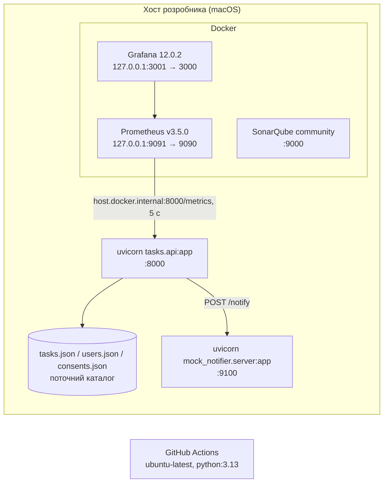

# ISD: Infrastructure Specification, Task Manager

| Поле | Значення |
|---|---|
| Версія | `d0fa985` (master) |
| Власник документа | MarcoGr11 (за git log); формальна роль потребує підтвердження студента |
| Цикл перегляду | 90 днів (експлуатаційний), див. [maintenance.md](maintenance.md) |
| Дизайн | [sdd.md](sdd.md) |

## 1. Топологія

Усе працює на одній машині розробника. Хмарного або продакшн-розгортання немає.

| Вузол | Що запускає | Порт | Джерело |
|---|---|---|---|
| API-процес | `uvicorn tasks.api:app --port 8000` | 8000 (`prometheus.yml` scrape target) | [SDD: API](sdd.md#sdd-api) |
| Mock notifier | `uvicorn mock_notifier.server:app --port 9100` | 9100 (`NOTIFIER_URL` за замовчуванням) | [SDD: Mock](sdd.md#sdd-mock) |
| Prometheus | `docker compose -f docker-compose.monitoring.yml up -d` | 127.0.0.1:9091 | `docker-compose.monitoring.yml` |
| Grafana | те саме (анонімний Viewer) | 127.0.0.1:3001 | `monitoring/grafana/` |
| SonarQube | `docker compose -f docker-compose.sonar.yml up -d` | 9000 (усі інтерфейси) | `docker-compose.sonar.yml` |

## 2. Середовища

| Середовище | Де | Дані | Хто запускає | Стан |
|---|---|---|---|---|
| dev | локальна машина, venv Python 3.13 | JSON у поточному каталозі; `python -m tasks.seed_users` (3 користувачі, 5 задач) або `python -m tasks.seed [N]` | розробник | є |
| test | `python -m pytest` локально | `tmp_path` для кожного тесту (`tests/conftest.py`, фікстура `privacy_env`), `respx` замість мережі | розробник, pre-commit не запускає тести | є (118 passed, coverage 92% на 2026-11-27) |
| CI | GitHub Actions, контейнер `python:3.13` | лише код, без даних | push, pull_request | є, але без тестів |
| prod | – | – | – | **не існує**. Цільова платформа потребує підтвердження студента |

## 3. Змінні оточення

Секретів у цих змінних немає. `.env.example` у корені містить їх із типовими значеннями.

| Змінна | Типове значення | Хто читає | Компонент SDD |
|---|---|---|---|
| `TASKS_DB` | `tasks.json` | `tasks/api.py`, `tasks/seed_users.py` | [Сховище](sdd.md#sdd-storage) |
| `USERS_DB` | `users.json` | `tasks/api.py`, `tasks/seed_users.py` | [Сховище](sdd.md#sdd-storage) |
| `CONSENTS_DB` | `consents.json` | `tasks/api.py`, `tasks/seed_users.py` | [Сховище](sdd.md#sdd-storage) |
| `NOTIFIER_URL` | `http://localhost:9100/notify` | `tasks/notifier_resilient.py` | [Нотифікатор](sdd.md#sdd-notifier) |
| `HOURLY_RATE`, `OVERLOAD_COEFF`, `DISCOUNT_RATE` | ставка обов'язкова (35-50), 1.3, 0.01 | `scripts/fin_sim.py` | не runtime (інструмент Лаби 9) |
| `AWS_ACCESS_KEY_ID` | порожньо | код не читає. Ключ є лише в `.env.example` для перевірки gitleaks | – |
| `SONAR_TOKEN` | лише в оточенні, ніколи у файлах | `sonar-scanner` | інструмент якості |

CLI (`tasks/cli.py`) змінних не читає: працює з `./tasks.json`.

## 4. Сховище, бекап, RTO/RPO

- **Сховище.** Три JSON-файли на локальному диску. Рішення описано в [ADR-0001](architecture/adr/0001-json-file-storage.md). `save_all` записує `*.tmp`, потім виконує `os.replace`.
- **Поточний бекап.** Відсутній. У репозиторії немає скрипта чи розкладу копіювання. Файли даних не відстежуються git.
- **Процедура (перевірена 2026-11-27, `docs/audit/restore_drill.txt`):**
  1. Бекап: `mkdir -p backup && cp -p *.json backup/`.
  2. Відновлення: `cp -p backup/*.json .`.
  3. Перевірка кількості записів через `tasks.api`.
  4. Результат виміру: `real 0.39` с для 5 задач, 3 користувачів і 0 згод. Відновлено 5, 3 і 0.

| Показник | Поточний стан | Ціль |
|---|---|---|
| RPO | не гарантовано: бекапу немає, втрачаються всі дані | дорівнює інтервалу копіювання; інтервал потребує підтвердження студента |
| RTO | не визначено | виміряно 0.39 с на копіювання та перевірку плюс перезапуск uvicorn. Цільове значення потребує підтвердження студента |

## 5. CI/CD і Quality Gates (Лаби 1-7)

| Етап | Де | Тригер | Gate | Лаба |
|---|---|---|---|---|
| Секрети | `.githooks/pre-commit`: `gitleaks git --pre-commit --staged --redact` | кожен `git commit` | блокує коміт; allowlist у `.gitleaks.toml` | 4 |
| Цикломатична складність | `.githooks/complexity_check.sh`: radon на staged-вміст | кожен `git commit` | блокує, якщо CC > `MAX_CC=10` | 6 |
| Активація хуків | `git config core.hooksPath .githooks` | один раз після клонування | без цього хуки не працюють | 6 |
| Тести та покриття | `python -m pytest` (`pytest.ini`: `--cov=tasks --cov-report=xml:coverage.xml`) | вручну | поріг не задано (coverage 92% на 2026-11-27) | 1-4 |
| Статичний аналіз | SonarQube локально, `sonar-project.properties` (ключ `task-manager`, Python 3.13, `coverage.xml`) | вручну, `SONAR_TOKEN` з оточення | Quality Gate SonarQube; конкретний профіль потребує підтвердження студента | 1, 3 |
| CI complexity | `.github/workflows/complexity.yml` | `push`, `pull_request` | не блокує. radon 6.0.1: cc, hal, mi; churn (вся історія і 90 днів); `scripts/hotspots.py`; артефакт `complexity-reports` | 7 |
| Навантаження | k6-скрипти (локально в `doc/k6/`, не в git) | вручну | з коміту 1cbb321: безпечний максимум 60 RPS, обвал на 70 RPS | 5 |

Останні 4 запуски CI (`gh run list --workflow complexity.yml`) усі `success`. Останній: 2026-11-08, `d0fa985`.
CD (розгортання) немає.

## 6. Моніторинг

- **Prometheus.** Збирає `host.docker.internal:8000/metrics` кожні 5 с (`monitoring/prometheus.yml`). Retention не задано, діє типове значення образу. Окремого тому для даних немає, тож дані зникають разом із контейнером.
- **Метрики API:**
  - HTTP count і latency histogram від `prometheus-fastapi-instrumentator`;
  - `app_process_cpu_percent` і `app_process_rss_bytes` через psutil.
- **Grafana.** Datasource `prom` (`http://prometheus:9090`), дашборд `monitoring/grafana/dashboards/lab5.json` «Task Manager - Lab5 Stability». Панелі: RPS, latency, CPU, RAM.
- **Логи.** stdout uvicorn, INFO. Фільтр `SensitiveDataFilter` маскує PII. Аудит-події пишуться JSON-рядками.
- **Алерти.** Не налаштовані.
