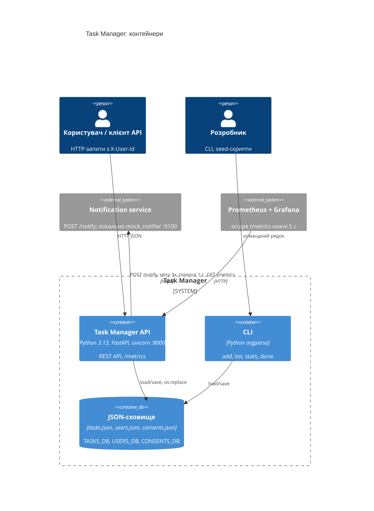

# SDD: Software Design Description, Task Manager

| Поле | Значення |
|---|---|
| Версія коду | `d0fa985` (master), Python 3.13, FastAPI |
| Власник документа | MarcoGr11 (єдиний автор комітів); формальна роль потребує підтвердження студента |
| Цикл перегляду | 180 днів (архітектурний), див. [maintenance.md](maintenance.md) |
| Інфраструктура | [isd.md](isd.md) |
| Рішення | [ADR-0001](architecture/adr/0001-json-file-storage.md), [ADR-0002](architecture/adr/0002-notifier-retry-fallback.md) |

## 1. Призначення

Навчальний сервіс керування задачами з:
- HTTP API: задачі, користувачі, експорт персональних даних, анонімізація, згоди;
- CLI для локальної роботи;
- сповіщенням зовнішнього сервісу про нову задачу з Retry + Fallback;
- метриками Prometheus.

Дані зберігаються у JSON-файлах.

## 2. C4: Container diagram

## 3. Компоненти

Кожен компонент має посилання на сусідів і на свій опис в ISD.

### 3.1 Task Manager API (`tasks/api.py`)
- **Відповідальність:**
  - HTTP-маршрути (розділ 5) і валідація вхідних даних через Pydantic (`TaskIn`, `UserIn`);
  - auth-заглушка `X-User-Id`, перевірка доступу `authorize_subject`;
  - аудит-події, кореляція `X-Correlation-Id`, `/metrics`.
- **Залежності:**
  - [Сховище](#sdd-storage) і [Нотифікатор](#sdd-notifier);
  - [Доменна логіка](#sdd-domain): `consent_policy`, `privacy`, `models`;
  - `logging_utils`; зовнішні бібліотеки `prometheus-fastapi-instrumentator` і `psutil`.
- **Інфраструктура:** [ISD: API-процес](isd.md#isd-api).

### 3.2 CLI (`tasks/cli.py`)
- **Відповідальність:** команди `add`, `list`, `stats`, `done` над `tasks.json` у поточному каталозі (`DEFAULT_DB`).
- **Залежності:** [Сховище](#sdd-storage), [Доменна логіка](#sdd-domain) (`reports`).
- **Інфраструктура:** [ISD: середовище dev](isd.md#isd-envs).

### 3.3 Доменна логіка
- **Модулі:** `models.py`, `reports.py`, `consent_policy.py`, `privacy.py`, `logging_utils.py`, `task_services.py`, `task_ports.py`, `notification_services.py`.
- **Відповідальність:**
  - модель задачі та звіти (статуси, прострочені задачі, urgency, CSV);
  - політика згод: перевірка версії політики та історія;
  - експорт і анонімізація персональних даних;
  - фільтр PII у логах.
- **Сервісні класи Лаби 8** (`TaskService`, `ConsentService`, `NotificationDispatcher`, `ReportExporter` через Protocol-порти) покриті тестами, але API їх ще не використовує: API працює зі сховищем напряму.
- **Залежності:** [Сховище](#sdd-storage) (лише через типи `Task` і `Consent`).
- **Інфраструктура:** не має окремого розгортання, працює в процесі [API](isd.md#isd-api).

### 3.4 Сховище (`tasks/storage.py`, `tasks/user_storage.py`, `tasks/consent.py`)
- **Відповідальність:**
  - `TaskStorage` читає і пише список `Task` у JSON;
  - `JsonStorage`, `UserStorage` і `ConsentStorage` працюють з dataclass-записами;
  - `save_all` спершу серіалізує всі файли в `*.tmp`, потім виконує `os.replace` для кожного файлу. Атомарність гарантована на рівні файлу, а не між файлами.
- **Залежності:** лише stdlib. Рішення описано в [ADR-0001](architecture/adr/0001-json-file-storage.md).
- **Інфраструктура:** [ISD: сховище і бекап](isd.md#isd-storage).

### 3.5 Клієнт нотифікатора (`tasks/notifier_resilient.py`)
- **Відповідальність:** `notify_task_created` надсилає `POST NOTIFIER_URL` з такими параметрами:

  | Параметр | Значення |
  |---|---|
  | Максимум спроб | 3 |
  | Timeout спроби | 1.0 с |
  | Backoff | 0.2 с, потім 0.4 с, плюс jitter до 0.1 с |
  | Що повторюється | помилки транспорту і HTTP 5xx |

  Якщо доставка не вдалася, функція повертає `delivered: false` без винятку. Задачу при цьому вже збережено.
- `tasks/notifier.py` – базовий клієнт без retry. Ні код, ні тести його не імпортують (dead code).
- **Залежності:** `httpx`, зовнішній [Notification service](#sdd-mock). Рішення описано в [ADR-0002](architecture/adr/0002-notifier-retry-fallback.md).
- **Інфраструктура:** [ISD: змінні оточення](isd.md#isd-env).

### 3.6 Mock Notifier (`mock_notifier/server.py`)
- **Відповідальність:** заглушка зовнішнього сервісу для fault injection.
  - `POST /_control?mode=ok|timeout|error` перемикає режим;
  - `POST /notify` відповідає `{"status":"sent"}`, 503 у режимі `error` і затримкою 10 с у режимі `timeout`.
- **Залежності:** FastAPI. Використовується [клієнтом нотифікатора](#sdd-notifier).
- **Інфраструктура:** [ISD: топологія](isd.md#isd-topology).

### 3.7 Seed та імпорт (`tasks/seed.py`, `tasks/seed_users.py`, `tasks/legacy_import.py`)
- **Відповідальність:**
  - `seed` генерує N задач (5000 за замовчуванням) для навантажувальних тестів;
  - `seed_users` створює 3 користувачі та 5 задач;
  - `legacy_import` імпортує CSV-подібний формат.
- **Залежності:** [Сховище](#sdd-storage).
- **Інфраструктура:** [ISD: середовища](isd.md#isd-envs).

## 4. Модель даних

| Сутність | Поля | Файл |
|---|---|---|
| `Task` | `id:int`, `title:str`, `priority: Priority(LOW=1, MEDIUM=2, HIGH=3)`, `status: Status(todo, in_progress, done)`, `due_date: date or null`, `tags: list[str]`, `owner_id: int or null` (→ `User.id`) | `TASKS_DB` |
| `User` | `id`, `name`, `email`, `phone`, `password_hash` (pbkdf2_sha256, 600 000 ітерацій), `reset_token`, `marketing_opt_in_source`, `is_admin`, `anonymized_at` | `USERS_DB` |
| `Consent` | `user_id` (→ `User.id`), `purpose` (`MARKETING_EMAIL`, `OPTIONAL_ANALYTICS`), `is_granted`, `policy_version` (поточна `2026-09`), `granted_at`, `withdrawn_at`, `source`, `updated_at`, `history: list[dict]` | `CONSENTS_DB` |

Правила:
- `password_hash`, `reset_token` і `is_admin` ніколи не повертаються назовні.
- Згода, видана для старішої версії політики, недійсна.

## 5. API-контракти

Відповіді у форматі JSON. Для маршрутів `/api/users/{user_id}/...`:
- потрібен заголовок `X-User-Id`: без нього 401;
- доступ до чужого або неіснуючого користувача дає однакову відповідь 403, щоб не розкривати, чи існує профіль;
- `X-Correlation-Id` необов'язковий: якщо його немає, генерується.

| Метод і шлях | Вхід | Успіх | Помилки |
|---|---|---|---|
| `GET /health` | – | 200 `{"status":"ok"}` | – |
| `GET /tasks` | – | 200 `[Task]` (`priority` як ім'я: `"HIGH"`) | – |
| `POST /tasks` | `{"title": str>=1, "priority": 1, 2 або 3}` (число; `"HIGH"` дає 422) | 201 `Task` + `notification_delivered: bool`, `notification_attempts: int` | 422 |
| `POST /api/users` | `{"name", "email", "phone", "password" (>=8)}` | 201 `{"id"}` | 422 невалідний або дубльований email |
| `GET /api/users/{user_id}/personal-data` | `X-User-Id` = `user_id` | 200 експорт (профіль без секретів, задачі, згоди) | 401, 403 |
| `POST /api/users/{user_id}/anonymize` | `X-User-Id` = `user_id` або адмін | 200 `{"subject_id", "status":"anonymized", "anonymized_at"}` | 401, 403, 500 (без змін) |
| `POST /api/users/{user_id}/consents/{purpose}/grant` | `purpose`, `?source=api` | 200 `Consent` | 401, 403, 422 невідома мета |
| `POST /api/users/{user_id}/consents/{purpose}/revoke` | те саме | 200 `Consent` або `{"is_granted": false}` | 401, 403, 422 |
| `POST /api/users/{user_id}/send-marketing-email` | `X-User-Id` = `user_id` | 200 `{"decision":"ALLOW","sent":true}` | 401, 403 (`DENY` без дійсної згоди) |
| `GET /metrics` | – | 200, формат Prometheus | – |

Асиметрія контракту: `POST /tasks` приймає пріоритет числом, а `GET /tasks` повертає його ім'ям. Це перевірено запитом через TestClient 2026-11-27: `priority: 3` дав 201 і `"HIGH"`, а `priority: "HIGH"` дав 422.
